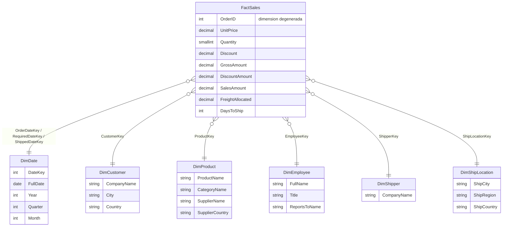

# Modelo estrella NorthWindDW

**Proceso de negocio:** ventas. **Granularidad:** una fila por línea de pedido (`OrderID` + `ProductID`).

## De dónde sale cada tabla

| Tabla destino | Tablas origen (OLTP) | Tipo |
|---|---|---|
| `dw.DimDate` | generada desde el rango de fechas de `Orders` | Dimensión (rol múltiple) |
| `dw.DimCustomer` | `Customers` | Dimensión, SCD Tipo 1 |
| `dw.DimProduct` | `Products` + `Categories` + `Suppliers` | Dimensión desnormalizada |
| `dw.DimEmployee` | `Employees` (+ auto-join para el jefe) | Dimensión |
| `dw.DimShipper` | `Shippers` | Dimensión |
| `dw.DimShipLocation` | `Orders` (ShipCity/Region/Country) | Dimensión |
| `dw.FactSales` | `OrderDetails` + `Orders` | Hechos |

**No se cargan al modelo:** `Region`, `Territories`, `EmployeeTerritories`, `CustomerCustomerDemo`, `CustomerDemographics`. Son relaciones muchos-a-muchos que no participan en el proceso de ventas; pueden añadirse como extensión (tabla puente).

## Decisiones de diseño
- **Llaves sustitutas** (`*Key`, IDENTITY) en las dimensiones; la llave original queda como llave de negocio (`CustomerID`, `ProductID`, ...).
- **Miembro "Desconocido" (clave -1)** en cada dimensión, para no perder hechos con llaves NULL (p. ej. pedido aún no enviado → `ShippedDateKey = -1`).
- **Flete (`Freight`)** vive en el pedido, no en la línea: se **prorratea** por venta neta de cada línea (`FreightAllocated`) para no duplicarlo al sumar.
- **Venta neta** = `UnitPrice × Quantity × (1 − Discount)`.
- **Orden de carga:** dimensiones → hechos (el hecho necesita las claves de las dimensiones).
- **Carga de hechos:** completa (truncate + insert). Idempotente y simple; una carga incremental con `rowversion` es una mejora posible (el OLTP ya trae esa columna y los procedimientos `Get*ChangesByRowVersion`).
