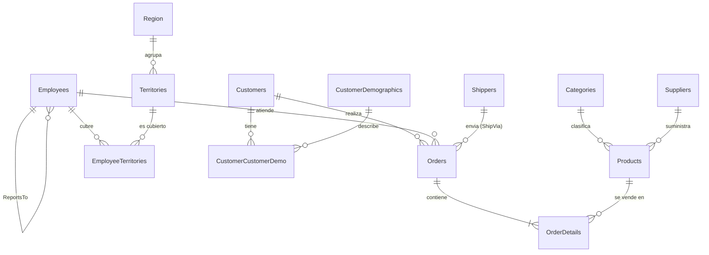

# Modelo OLTP NorthWind (13 tablas)

**Por qué es OLTP:** esquema normalizado con llaves primarias/foráneas, tablas de catálogo (Categories, Shippers, Region...) separadas de las transaccionales (Orders, OrderDetails), restricciones CHECK/DEFAULT y columnas `rowversion` para control de cambios.
